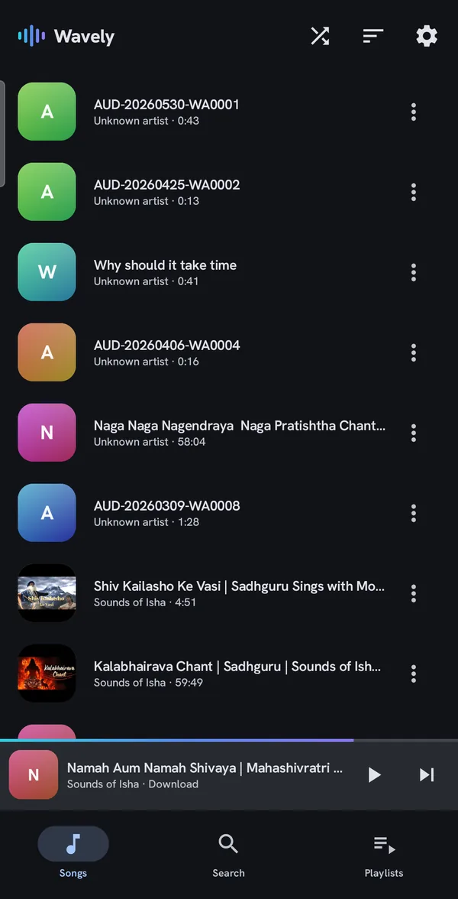
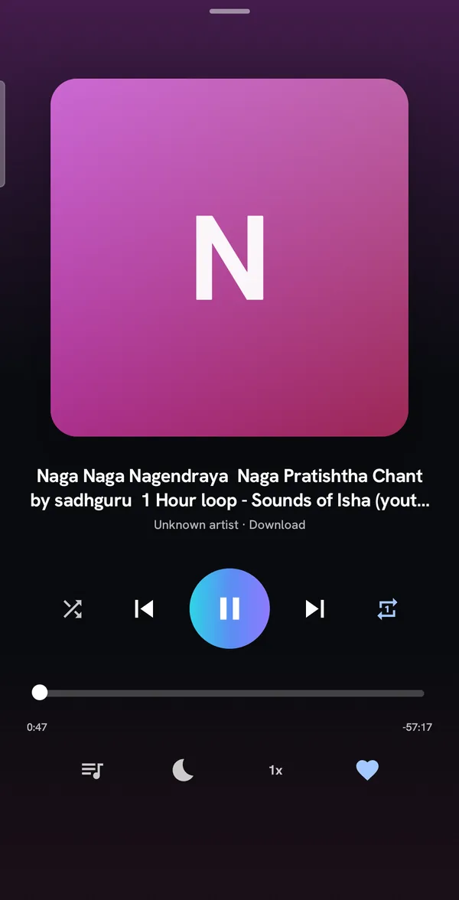
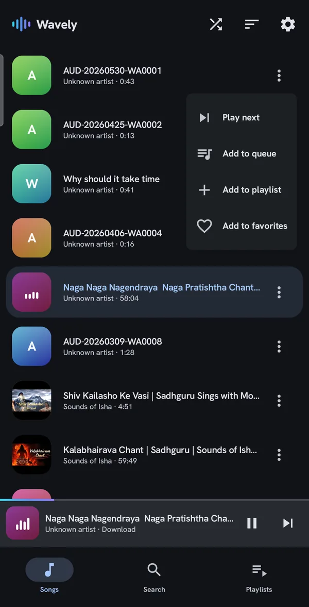
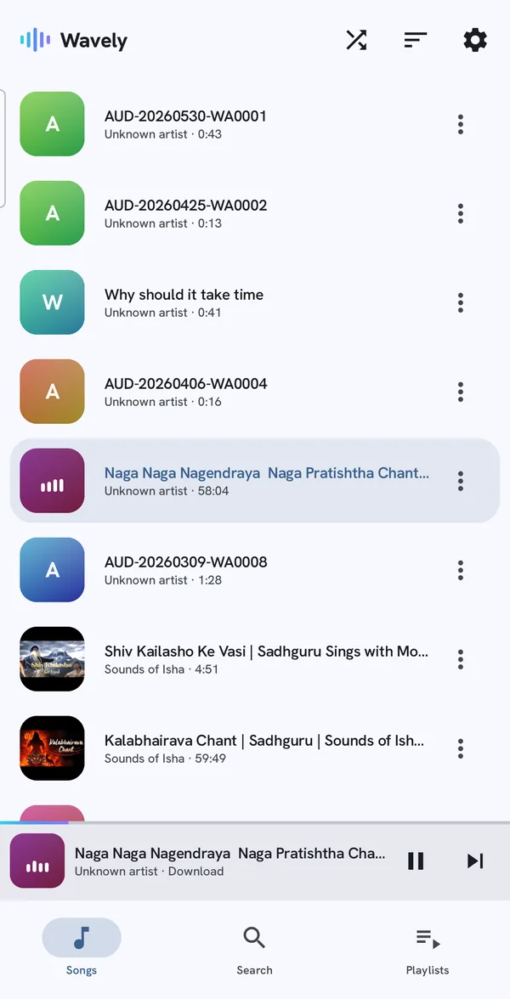

<p align="center">
  
</p>

<h1 align="center">Wavely</h1>

<p align="center">
  A calm, minimal music player for the songs already on your Android phone.<br>
  No account · No ads · No tracking · No internet permission
</p>

<p align="center">
  <a href="https://github.com/imbikramsaha/Wavely/releases/download/v2.0.0/Wavely-2.0.0.apk"></a>
  &nbsp;
  <a href="https://imbikramsaha.github.io/Wavely/"></a>
</p>

<p align="center">
  
  
  
  
  <a href="https://github.com/imbikramsaha/Wavely/actions/workflows/ci.yml"></a>
</p>

<p align="center">
  
  
  
  
</p>

---

## Download

**[⬇️ Download Wavely 2.0.0 (APK, 2.7 MB)](https://github.com/imbikramsaha/Wavely/releases/download/v2.0.0/Wavely-2.0.0.apk)** · requires Android 8.0 (Oreo) or newer

You can also get it from the **[Wavely website](https://imbikramsaha.github.io/Wavely/)**, or browse every version on the **[Releases page](https://github.com/imbikramsaha/Wavely/releases)**.

### Install

1. Open the download link above **on your Android phone**.
2. Open the downloaded `Wavely-2.0.0.apk`. If Android asks, allow your browser or file manager to **install unknown apps**.
3. Tap **Install**, open Wavely, and grant access to **Music and audio**. Your library appears right away.

> **Updating from an older version?** Install the new APK over the existing app. Every release is signed with the same key, so your playlists and favorites are kept.

<details>
<summary><b>Verify your download</b></summary>
<br>

| | |
|---|---|
| File | `Wavely-2.0.0.apk` (2,851,930 bytes) |
| File SHA-256 | `7783b784daf7372f25caa56488d45efd0c49750ff3751fa1b9a33a908b482358` |
| Signing certificate SHA-256 | `f4a72cb2e772e0fc70ba0fc7e9567a8bf2b22bc019828480efe41332688c882a` |
| Package name | `com.wavely.player` |
| Version | 2.0.0 (version code 5) |

```bash
sha256sum Wavely-2.0.0.apk
apksigner verify --print-certs Wavely-2.0.0.apk
```

</details>

## Features

- **Truly offline.** Plays the audio files on your device. No sign-in, no streaming, no network required.
- **Background playback.** Media notification, lock-screen controls, headset buttons, and proper audio-focus handling.
- **A queue that behaves.** Play next, add to queue, drag to reorder, swipe to remove with undo. Shuffle and repeat included.
- **Playlists and favorites.** Create, rename, reorder, and delete playlists. Heart a song to keep it one tap away.
- **Sleep timer and playback speed.** Fall asleep to music, or speed up podcasts and lectures.
- **Search and sort.** Find songs by title or artist. Sort by title, date added, or duration.
- **Multi-select.** Long-press to select several tracks, then queue them or add them to a playlist in one go.
- **Light, dark, and Material You.** Follows your system theme, with optional dynamic color from your wallpaper.
- **Generated artwork.** Tracks without cover art get a soft gradient tile instead of a blank square.
- **Picks up where you left off.** Your queue and position are restored the next time you open the app.
- **Phones, tablets, and landscape.** A navigation rail and two-pane Now Playing appear on wider screens.

## Privacy

Wavely has no analytics, no ads, and no servers. It **does not request the internet permission**, so nothing you play can leave your phone.

| Permission | Why |
|---|---|
| Music and audio (`READ_MEDIA_AUDIO`, or `READ_EXTERNAL_STORAGE` on Android 12 and below) | To find the songs stored on your device |
| Notifications | To show playback controls in the notification shade and on the lock screen |
| Foreground service (media playback) | To keep playing when the app is in the background |

---

## For developers

### Tech stack

Kotlin · Jetpack Compose (Material 3) · Media3 / ExoPlayer · Room · Hilt · Paging 3 · DataStore · Coroutines/Flow

| | |
|---|---|
| Min / target SDK | 26 / 35 |
| Build | AGP 8.7.3 · Gradle 8.11.1 · Kotlin 2.1.0 · KSP 2.1.0-1.0.29 · JDK 17 |
| Libraries | Compose BOM 2024.12.01 · Media3 1.5.1 · Room 2.6.1 · Hilt 2.53.1 · Paging 3.3.5 |

### Project structure

```
:domain   Pure Kotlin. Models, repository interfaces, use cases (no Android imports).
:data     MediaStore scanning, Room DB, Media3 MediaSessionService + MediaController,
          repository implementations, DataStore settings, Hilt wiring.
:app      Compose UI: single Activity + NavHost, bottom nav / navigation rail,
          mini-player, Now Playing sheet, screens and ViewModels.
docs/     The project website (GitHub Pages).
```

The full product and engineering spec lives in [`design.md`](design.md). The v2 visual design handoff (tokens, logo, screens) is in [`v2 design/`](v2%20design/).

### Build from source

Requirements: **JDK 17** and the **Android SDK (API 35)**. Android Studio Ladybug or newer is the easiest route.

- **Android Studio:** open the project folder and let Gradle sync, then run the `app` configuration.
- **Command line:** the Gradle wrapper JAR isn't committed, so use a system Gradle **8.11.1** (or run `gradle wrapper` once to generate `./gradlew`):

```bash
gradle :app:assembleDebug     # debug APK → app/build/outputs/apk/debug/
gradle :app:installDebug      # install on a connected device
gradle test                   # JVM unit tests (domain, data, app)
gradle lint                   # Android Lint
```

#### Release builds

Release signing is read from a `keystore.properties` file in the project root. The file is gitignored and must never be committed:

```properties
storeFile=your-release-key.jks
storePassword=…
keyAlias=…
keyPassword=…
```

Then run `gradle :app:assembleRelease`. Without the file, the release build is produced unsigned.

### Architecture notes

- **Stable track identity.** Playlists, the queue, and favorites are keyed by `{path + size + date_added}` (`TrackIdentity`) and re-resolved against MediaStore on load, never the mutable MediaStore `_ID`. Regression-tested in `MediaRepositoryImplTest`.
- **Playback.** `PlaybackService : MediaSessionService` owns ExoPlayer, with audio focus and becoming-noisy handling enabled. The UI drives it through a `MediaController` wrapper (`PlaybackConnection`) and never touches Media3 directly.
- **Shuffle and queue.** Shuffle uses Media3's built-in shuffle order. Queue edits while shuffled preserve the current track.
- **Now Playing.** The mini-player and sheet share one hierarchy, and expansion follows the drag fraction. Landscape uses a two-pane layout, and expanded widths use a persistent side panel. Predictive back collapses the sheet.
- **Large libraries.** Lists are paged with Paging 3. The position ticker runs only while playing *and* in the foreground, to save battery.
- **Resilience.** Unplayable or deleted tracks are skipped with a toast. A revoked permission yields an empty library instead of a crash. The session is saved on backgrounding and restored (paused) after process death.

### Tests and CI

JVM unit tests cover track identity, sorting, repeat modes, the previous-track rule, duration formatting, and the speed cycle. GitHub Actions ([`ci.yml`](.github/workflows/ci.yml)) runs `gradle test` and `gradle lint` on every push and pull request.

### Website

The landing page at **[imbikramsaha.github.io/Wavely](https://imbikramsaha.github.io/Wavely/)** is a single static file, [`docs/index.html`](docs/index.html), served by GitHub Pages from the `docs/` folder on `main`. Its download buttons fetch the newest GitHub Release automatically, so publishing a new release with an `.apk` asset updates the site with no code change.

---

<p align="center">
  Made by <a href="https://github.com/imbikramsaha">Bikram Saha</a>
</p>
